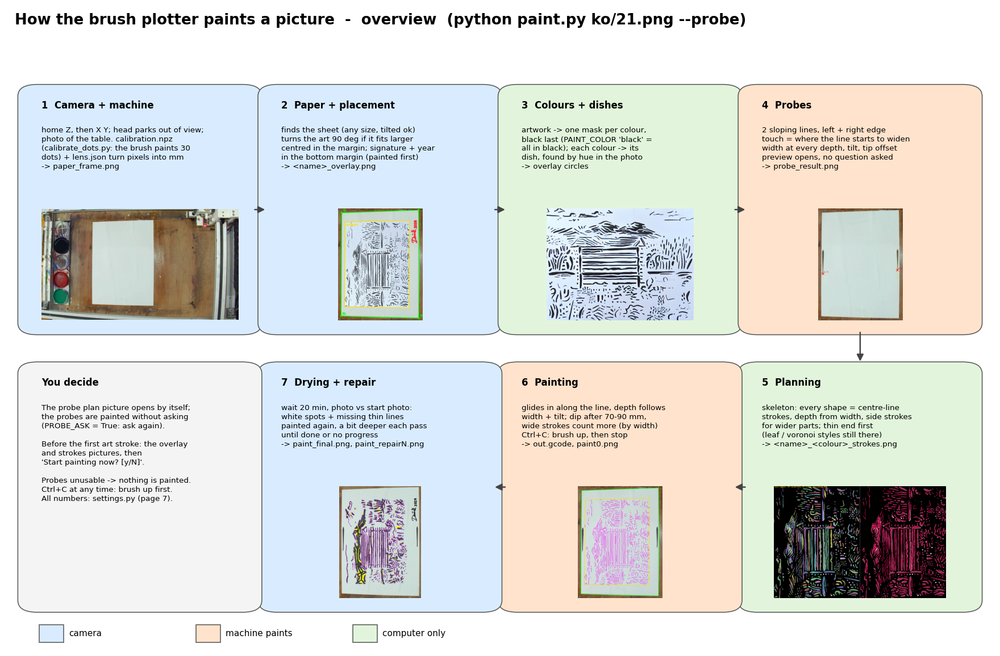

# Brushography: a camera-guided brushograph

Python software that turns a black-and-white (or few-colour) picture into real brush strokes on paper. The machine is a
G-code plotter with a paint brush in place of a pen. A camera looks down at the table, so the program knows where the
sheet lies, where the paint dishes are, how deep the brush has to go to make a line of a given width, and what is still
missing once the painting is done.



## What it does

1. **Camera + machine.** Homes the machine, parks the head out of view and photographs the table. A one-time calibration
   (`calibrate_grid.py` for the lens, `calibrate_dots.py` for camera to machine mm) turns pixels into machine coordinates.
2. **Paper + placement.** Finds the sheet (any size, may be tilted), fits the artwork into it, turns it 90° if it fits
   bigger that way. An optional signature + year is painted in the artwork's bottom right corner.
3. **Colours + dishes.** Splits the artwork into one mask per colour (black last) and finds each colour's dish by its hue
   in the photo.
4. **Probes.** Paints two sloping lines in the margin and measures where the brush starts to touch and how wide it paints
   at every depth: the paper tilt, the touch height and a width-to-depth curve for *this* brush, paint and paper.
5. **Planning.** Every shape becomes centre-line strokes (skeleton); the brush depth along each stroke follows the
   width of the shape. Wider parts get side strokes. Thin ends are painted first.
6. **Painting.** Strokes are landed and lifted while moving (no dots), with a dip in the dish every 70–90 mm of painting.
7. **Drying + repair.** After drying, the finished sheet is photographed and compared with the artwork. White spots and
   missing thin lines are painted again, a little deeper each pass, until nothing is missing or no progress is made.

The full illustrated walk-through is in [docs/system_workflow.pdf](docs/system_workflow.pdf).

## Hardware

- A 3-axis G-code machine (XY plotter with a Z axis) on a serial port, Marlin-style commands (`G0/G1`, `M204`, `M400`).
- A brush in the toolhead, paint dishes on the table beside the paper.
- A USB camera above the table that sees the whole sheet and the dishes (1920×1080 used here).

## Install

Python 3.10 or newer.

```
pip install -r requirements.txt
```

## Setup (once per machine)

All numbers live in **[settings.py](settings.py)**: serial port, camera, heights, speeds, dish positions, line and
signature options. Every setting has a comment explaining it. Start with:

- `SERIAL_PORT`, `CAMERA_INDEX`: check with `python serial_test.py` and `python preview.py --list`.
- `TOUCH_Z`: the machine Z where the brush tip touches the paper (rough; the probes measure it exactly).
- `SIGNATURE`: a picture of your signature (black on white), or `None` for no signature.

Settings that only apply to your own computer (your machine, your camera) go in `settings_local.py` next to
`settings.py`: it is not in git, it is read last and what it sets wins, e.g. `SERIAL_PORT = "COM3"`.

Then calibrate the camera:

```
python calibrate_grid.py preview_snapshot.png   # the lens, once per camera (a photo of a ruled grid sheet)
python calibrate_dots.py                         # camera <-> machine mm: the brush paints a grid of dots and the camera finds them
```

The files in this repository (`lens.json`, `calibration.npz`, `calib_dots.json`, `ladder_dataset/`) are the calibration
of the author's machine. They are a working example; on another machine they must be measured again.

## Painting

```
python paint.py examples/example_54.png                 # probes, plan, ask, paint, dry, repair
python paint.py examples/example_54.png --plan_only     # only look with the camera and plan: nothing moves
python paint.py picture.png --frame paper_frame.png     # plan on a saved camera picture (no camera, no machine)
```

`python paint.py --help` lists every option. Ctrl+C at any time lifts the brush first, then stops.

Each run writes, next to the scripts: the G-code (`<name>.gcode`), the plan pictures (`<name>_overlay.png`,
`<name>_<colour>_strokes.png`), the probe result (`probe_result.png`) and photos of the sheet during and after the
painting (`paint0.png`, `paint_final.png`, `paint_repairN.png`).

## Files

| File | What it does |
|---|---|
| `paint.py` | The main program: paper, colours, probes, planning, G-code, painting, repair |
| `settings.py` | Every number and option, with comments |
| `probe.py` | Probe lines in the margin: touch height, paper tilt, width-to-depth curve |
| `vision.py` | Camera: capture, pixel <-> machine mm, the paper, the paint pools |
| `machine.py` | Serial connection to the machine |
| `leaf_style.py` | Alternative "leaf" / voronoi infill style for wide shapes |
| `signature.py` | Signature + year as paint strokes |
| `checkup.py`, `check.py` | Which planned strokes are not on the paper (after the job / while painting) |
| `gap_repair.py` | Stand-alone repair of gaps from a photo and the job's G-code |
| `brush_profile.py`, `train.py` | The brush "ladder": strokes at fixed depths, measured into a profile (`ladder_dataset/`) |
| `calibrate_grid.py`, `calibrate_dots.py`, `calibrate.py` | Camera lens and camera-to-machine calibration |
| `calibration_verify.py`, `check_paper_frame.py`, `preview.py` | Live camera checks |
| `serial_test.py`, `touch_test.py` | Machine connection test, touch height by hand |
| `docs/` | Workflow PDF and diagrams |
| `examples/` | Example artworks to try |

## License

[MIT](LICENSE) © 2026 Dominik Mahnič
